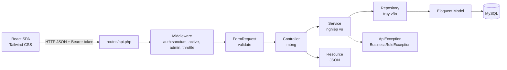
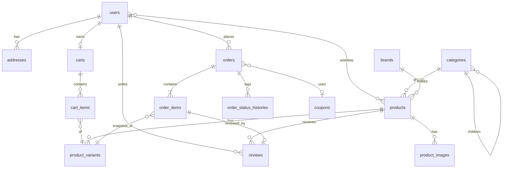
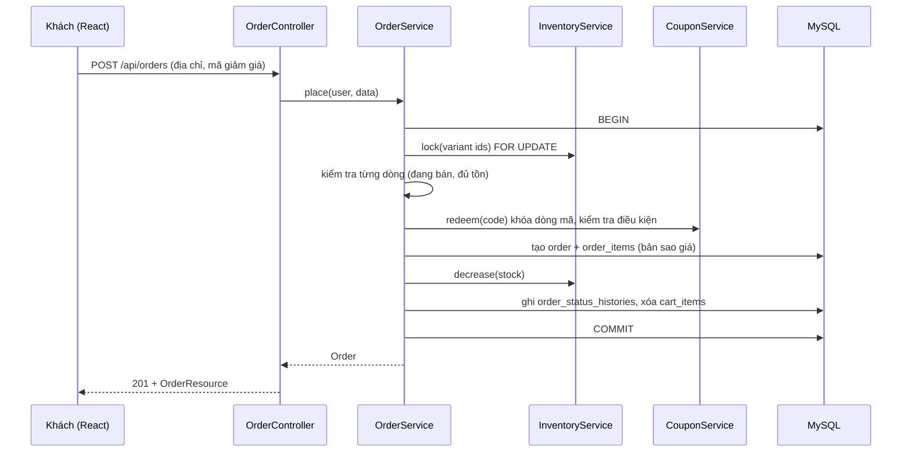
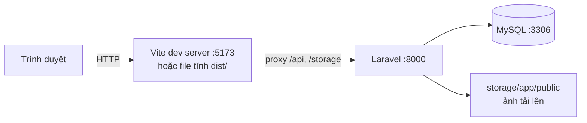

# Kiến trúc hệ thống Mela (cửa hàng Apple)

Tài liệu dùng cho chương 2 (Thiết kế hệ thống) và chương 4 (Cài đặt) của báo cáo.

## 1. Kiến trúc phân tầng

| Tầng | Thư mục | Trách nhiệm |
|---|---|---|
| Route + Middleware | `routes/api.php`, `app/Http/Middleware` | Định tuyến, xác thực Sanctum, chặn tài khoản khóa, phân quyền admin, giới hạn tốc độ |
| Request | `app/Http/Requests/{Admin,User,Auth}` | Validate và chuẩn hóa dữ liệu đầu vào, thông báo lỗi tiếng Việt |
| Controller | `app/Http/Controllers/API/{Admin,User}` | Nhận request, gọi một Service, trả Resource; không chứa nghiệp vụ |
| Service | `app/Services` | Toàn bộ nghiệp vụ: đặt hàng, tồn kho, mã giảm giá, trạng thái đơn, đánh giá, báo cáo |
| Repository + Interface | `app/Repositories`, `app/Interfaces` | Truy vấn dữ liệu; Service chỉ phụ thuộc Interface (gắn trong `AppServiceProvider`) |
| Model | `app/Models` | Ánh xạ bảng, quan hệ, cast; `OrderStatus` là enum có máy trạng thái |
| Resource | `app/Http/Resources` | Định dạng JSON, ẩn dữ liệu nhạy cảm (mật khẩu, ghi chú nội bộ chỉ admin thấy) |

Giảm trùng lặp: `BaseRepository` (CRUD + phân trang) và `CrudService` (danh mục, thương hiệu, banner, mã giảm giá, liên hệ) dùng chung.

## 2. Sơ đồ dữ liệu

Mô hình sản phẩm: `products` giữ thông tin chung (tên, câu giới thiệu `tagline`, `option_label` là tên tùy chọn cấu hình như *Dung lượng* hay *Cấu hình*, `highlights` và `specs` dạng JSON, `in_the_box`, `warranty`); `product_variants` là từng phiên bản bán được (cấu hình × màu) có SKU, giá riêng, tồn kho và ảnh riêng. Nhờ vậy cùng một mẫu iPhone có nhiều dung lượng và màu với giá khác nhau, còn thông số kỹ thuật nhập một lần ở trang quản trị.

Bảng khác: `banners`, `content_pages`, `settings`, `contact_requests`, `personal_access_tokens`. Đơn hàng lưu **bản sao** tên, giá, SKU và địa chỉ để thay đổi danh mục hay sổ địa chỉ không làm đổi lịch sử mua.

## 3. Luồng đặt hàng (sequence)

Lỗi ở bất kỳ bước nào ném `BusinessRuleException` và transaction được hoàn tác.

## 4. Triển khai

## 5. Đối chiếu chức năng với báo giá (Phần 1)

### Khách hàng

| # | Chức năng | Trang frontend | API chính |
|---|---|---|---|
| 1 | Trang chủ | `/` | `GET /banners`, `/products`, `/settings` |
| 2 | Danh sách sản phẩm | `/products` | `GET /products` (q, category, brand, min_price, max_price, configuration, color, sort, page) |
| 3 | Chi tiết sản phẩm | `/products/:slug` | `GET /products/{id\|slug}`, `/related` |
| 4 | Đánh giá sản phẩm | `/reviews`, mục đánh giá ở chi tiết | `GET /products/{key}/reviews`, `POST/PUT/DELETE /reviews` |
| 5 | Yêu thích | `/wishlist` | `GET/POST/DELETE /wishlist` |
| 6 | Giỏ hàng | `/cart` | `GET/POST/PUT/DELETE /cart…` |
| 7 | Đăng ký, đăng nhập, quên mật khẩu | `/register`, `/login`, `/forgot-password`, `/reset-password` | `/auth/*` |
| 8 | Hồ sơ cá nhân | `/profile` | `/profile`, `/profile/password`, `/profile/avatar` |
| 9 | Địa chỉ nhận hàng | `/addresses` | `/addresses…` |
| 10 | Đặt hàng, thanh toán COD | `/checkout`, `/checkout/success` | `POST /checkout/preview`, `POST /orders` |
| 11 | Khuyến mãi, mã giảm giá | Ô mã ở `/checkout`, nhãn giảm giá trên thẻ | `POST /coupons/validate` |
| 12 | Đơn hàng và chi tiết | `/orders`, `/orders/:code` | `GET /orders`, `POST /orders/{code}/cancel` |
| 13 | Liên hệ và chính sách | `/contact`, `/policies`, `/about` | `POST /contact-requests`, `GET /pages` |

### Quản trị

| # | Chức năng | Trang | API chính |
|---|---|---|---|
| C1 | Đăng nhập, phân quyền | `/login`, route guard `/admin` | `/auth/login`, middleware `admin`, `active` |
| C2 | Dashboard | `/admin` | `GET /admin/dashboard` |
| C3 | Sản phẩm | `/admin/products` | `/admin/products…` (ảnh, trạng thái) |
| C4 | Lựa chọn và tồn kho | `/admin/inventory`, trong form sản phẩm | `/admin/variants…`, `/admin/inventory` |
| C5 | Danh mục, thương hiệu | `/admin/categories`, `/admin/brands` | `/admin/categories…`, `/admin/brands…` |
| C6 | Trang chủ và nội dung | `/admin/content`, `/admin/settings` | `/admin/banners…`, `/admin/pages`, `/admin/settings` |
| D7 | Đơn hàng | `/admin/orders` | `/admin/orders…` (status, note, payment) |
| D8 | Khách hàng, tài khoản | `/admin/users` | `/admin/users…` (status, role) |
| D9 | Đánh giá | `/admin/reviews` | `/admin/reviews…` (visibility, reply) |
| D10 | Khuyến mãi, phí giao hàng | `/admin/coupons`, `/admin/settings` | `/admin/coupons…`, `/admin/settings` |
| D11 | Yêu cầu liên hệ | `/admin/contacts` | `/admin/contact-requests…` |
| D12 | Báo cáo, thống kê | `/admin/reports` | `GET /admin/reports`, `/admin/reports/export` (CSV) |

## 6. Bảo mật

- **Authentication:** Laravel Sanctum, token hết hạn sau 7 ngày; đăng xuất và đổi/đặt lại mật khẩu thu hồi token; khóa tài khoản xóa mọi token.
- **Authorization:** middleware `admin` cho `/api/admin/*`; mọi dữ liệu cá nhân (giỏ, địa chỉ, đơn, đánh giá) luôn lọc theo người dùng đang đăng nhập; quản trị viên không thể tự khóa/hạ quyền hoặc khóa quản trị viên cuối cùng.
- **Validate:** mọi đầu vào qua FormRequest; số điện thoại, mật khẩu (≥ 8 ký tự), tệp ảnh (jpg/png/webp ≤ 4MB).
- **Chống lạm dụng:** giới hạn tốc độ cho đăng nhập, đăng ký, quên mật khẩu và gửi liên hệ; thông báo đăng nhập sai không lộ email có tồn tại hay không; quên mật khẩu luôn trả cùng một thông báo.
- **Toàn vẹn dữ liệu:** transaction và khóa dòng cho tồn kho và mã giảm giá; khóa ngoại `restrict` bảo vệ lịch sử mua hàng.
